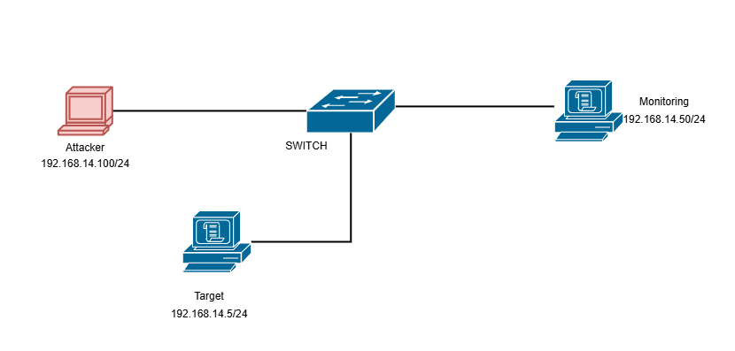

# IP Plan – Kelompok 14 (Proyek IoT PiRoTech)

**Subnet Kelompok:** `192.168.14.0/24`  
**Mode Jaringan:** Host-only / Internal Network (Isolated Lab)  
**Topik Sistem IoT:** PiRoTech (*Sistem Monitoring, Analisis, dan Kendali Reaktor Pirolisis Sampah Plastik Berbasis IoT & Cloud Web*)

---

## 1. Tabel Alokasi IP & Spesifikasi Node

| Hostname | IP Address | OS Awal (Minggu 4) | OS Replika PiRoTech (Fase 1–2) | Keterangan Peran dalam Simulasi SOC |
| :--- | :--- | :--- | :--- | :--- |
| **Target Server (Korban)** | `192.168.14.5/24` | Metasploitable 2 | **Ubuntu Server 22.04 LTS** (Replika Backend PiRoTech) | Menjalankan replika tech stack PiRoTech: Nginx, Next.js 16 (Node.js 20+), serta Firebase RTDB & Auth Emulator dengan data telemetri sintetis |
| **Attacker Node** | `192.168.14.100/24` | Kali Linux | **Kali Linux / CyberOps VM** | Digunakan Red Team untuk *reconnaissance*, eksploitasi endpoint API, brute-force, & simulasi *telemetry spoofing* ESP32 |
| **Monitoring Node** | `192.168.14.50/24` | Security Onion | **Security Onion** (SIEM & IDS) | Memantau seluruh trafik di segmen `192.168.14.0/24` melalui interface *Promiscuous Mode (Allow All)* |

---

## 2. Daftar Port, Service, & Potensi Celah Keamanan pada Target Node (`192.168.14.5`)

Pemetaan port di bawah ini menggabungkan hasil riset celah layanan dasar pada Minggu ke-4 dengan layanan spesifik dari arsitektur **PiRoTech**:

| Port | Service / Komponen PiRoTech | Status Awal (Sebelum Hardening) | Status Setelah Hardening (UFW) | Potensi Celah Keamanan (Hasil Riset Red Team & Blue Team) |
| :-: | :--- | :--- | :--- | :--- |
| `80` | **HTTP (Nginx Reverse Proxy)** | Terbuka | **Terbuka (Rate-Limited)** | Trafik dikirim tanpa enkripsi (HTTP), sehingga payload JSON telemetri sensor (`temperature_c`), polling `/control/buzzer.json`, maupun kredensial login rawan disadap (*sniffing* / *MITM*) di jaringan lokal. |
| `443` | **HTTPS (TLS 1.2)** | Opsional | **Terbuka** | Meski terenkripsi, pada komunikasi IoT ESP32 (`WiFiClientSecure`) tetap rawan disalahgunakan lewat sertifikat palsu (*self-signed*) atau serangan *Man-in-the-Middle* jika validasi sertifikat diabaikan. |
| `22` | **SSH (OpenSSH Server)** | Terbuka (Port 22) | **Dipindah ke Port `2222` (SSH Key Only + Fail2Ban)** | Meskipun terenkripsi, port default 22 dengan autentikasi password dan izin `PermitRootLogin yes` sangat rentan terhadap serangan *brute-force* & *dictionary attack* (Hydra). |
| `3000` | **Next.js 16.3.0 Web & API Server** | Terbuka ke publik (`0.0.0.0`) | **Ditutup dari luar** (Hanya `127.0.0.1` via Nginx) | Eksposur langsung ke server aplikasi internal; memiliki celah *Information Disclosure* pada endpoint `/api/debug/env` (membocorkan status `FIREBASE_PRIVATE_KEY`) serta *Username Enumeration* tanpa batas request pada `/api/auth/lookup`. |
| `9000` | **Firebase RTDB Emulator (NoSQL JSON)** | Terbuka ke publik (`0.0.0.0`) | **Ditutup dari luar** (Hanya `127.0.0.1` via Nginx) | Menggantikan fungsi database relasional (MySQL); aturan awal `firebase.rules.json` pada node `/sensor_data` memiliki konfigurasi `.write: true` (tanpa autentikasi), sehingga penyerang dapat menyuntikkan suhu palsu (*Fake Overheat*) atau memanipulasi status `/control/buzzer.json`. |
| `9099` | **Firebase Auth Emulator** | Terbuka ke publik (`0.0.0.0`) | **Ditutup dari luar** (Hanya `127.0.0.1` via Nginx) | Mengelola token JWT dan Custom Claims (`role: admin \| operator`); jika terekspos langsung tanpa firewall, rawan terhadap upaya pembuatan akun ilegal atau manipulasi token otorisasi. |
| `21` / `23` | **FTP & Telnet (Layanan Legacy)** | Terbuka (di baseline awal) | **Dinonaktifkan Permanen** | Layanan *legacy* yang tidak dibutuhkan oleh sistem PiRoTech; mengirimkan kredensial dalam bentuk *plaintext* dan memperluas *attack surface* server. |
